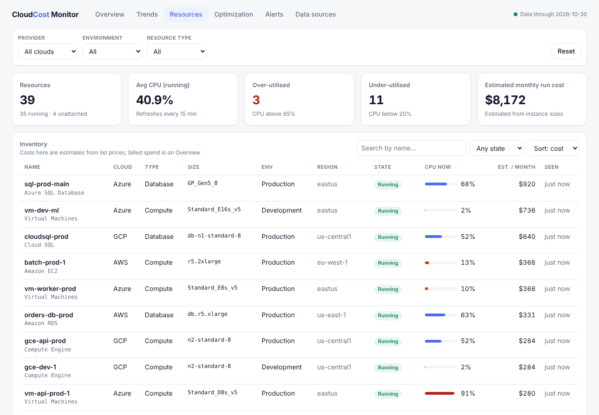
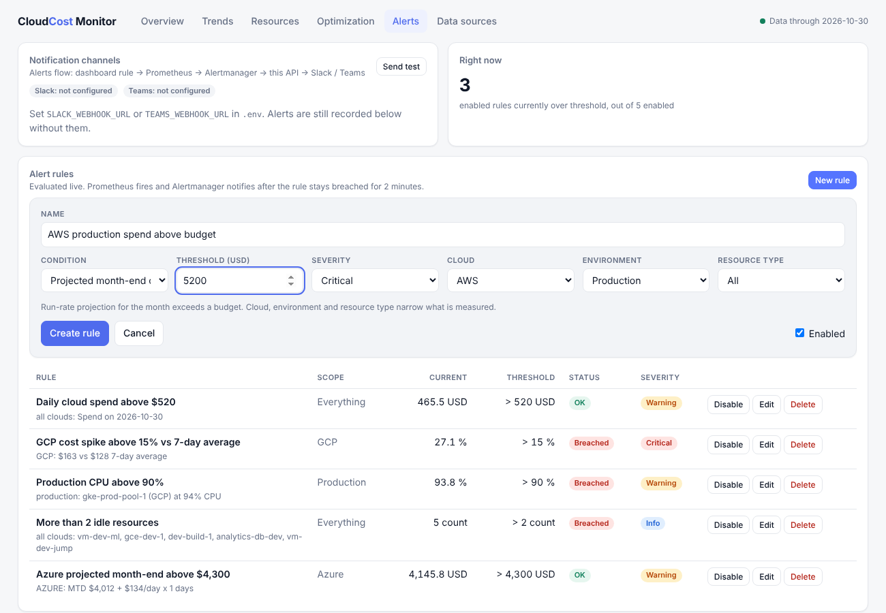
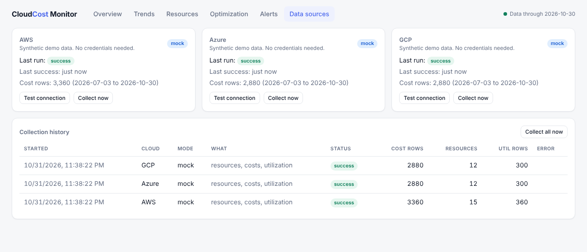

# DevOps Dashboard for Resource and Cost Monitoring

One dashboard for cloud spend and resource usage across **AWS, Azure and GCP**. It collects cost and
utilisation data, shows live and historical charts with filters, sends **alerts to Slack or Microsoft
Teams**, and recommends where to cut waste, with the saving in dollars.

It runs out of the box on built-in demo data, so **no cloud account is needed to try it**. Each cloud
switches to live data with one setting.

## Contents

1. [Why this project](#why-this-project)
2. [Features](#features)
3. [Screenshots](#screenshots)
4. [Architecture](#architecture)
5. [How alerting works](#how-alerting-works)
6. [Data model](#data-model)
7. [Cost optimisation](#cost-optimisation)
8. [Technology stack](#technology-stack)
9. [Quick start](#quick-start)
10. [Configuration](#configuration)
11. [Connecting real clouds](#connecting-real-clouds)
12. [Slack and Teams notifications](#slack-and-teams-notifications)
13. [API reference](#api-reference)
14. [Prometheus metrics](#prometheus-metrics)
15. [Project structure](#project-structure)
16. [Testing](#testing)
17. [Sprint plan](#sprint-plan)
18. [Known limitations](#known-limitations)
19. [Further documentation](#further-documentation)

---

## Why this project

Teams that run on several clouds struggle to see what they use and what it costs. Each provider has its own
console, its own billing format and its own vocabulary, so waste and surprise bills go unnoticed. This project
puts all three clouds into one place and answers four questions:

| Goal from the project brief | How it is met |
| --- | --- |
| Aggregate usage and cost from AWS, Azure and GCP into one dashboard | One collector per cloud feeds a single shared database schema |
| Real-time and historical visualisation | Inventory and CPU refreshed every 15 minutes; monthly, daily and per-service trends |
| Customisable alerts for cost thresholds and over-used resources | Seven rule types created in the UI, delivered to Slack or Teams through Prometheus and Alertmanager |
| Filters and drill-down by cloud, resource type and environment | One shared filter bar, plus date range and a per-service breakdown |

## Features

**Collect**
- Collectors for **AWS** (Cost Explorer, EC2, RDS, EBS, CloudWatch), **Azure** (Cost Management, Compute, Monitor) and **GCP** (BigQuery billing export, Compute Engine, Cloud Monitoring).
- A **demo-data collector** with realistic weekly patterns, growth, planted cost spikes and a mix of busy, idle and over-used resources.
- Environment tags (`prod`, `PRD`, `dev-2`, ...) and service names are mapped to one shared set of environments and resource types.
- Re-running a collection never creates duplicates, and late billing revisions are corrected automatically.

**Show**
- Spend in a period with change versus the previous period, month to date, and a month-end projection.
- Daily cost stacked by cloud, environment, resource type or service.
- Monthly totals and month-over-month change, compared per day so a partial month is fair.
- Resource inventory with current CPU and estimated monthly cost.
- Cost anomaly detection that flags days far above a service's recent baseline.

**Alert**
- Seven rule types (daily cost, month-to-date, projected month-end, cost spike, high CPU, idle count, potential savings), each limited to a cloud, environment or resource type.
- Rules are created, edited, disabled and deleted in the dashboard. No Prometheus config change is needed.
- Messages go to Slack and Microsoft Teams, with a resolved message when the problem clears.

**Optimise**
- Six recommendation types with a dollar saving, a confidence level and the action to take. See [Cost optimisation](#cost-optimisation).

## Screenshots

All screenshots use the built-in demo data.

### Overview
Spend, month-end projection, daily cost stacked by cloud, share by cloud / environment / resource type, and detected cost anomalies.


### Trends
Monthly cost by cloud, month-over-month change, total daily cost, average CPU over time and cost by service.


### Resources
Inventory across all clouds with state, current CPU and estimated monthly cost. Searchable and sortable.



### Optimization
Savings found by the optimiser, grouped by type, with the exact action for each resource.


### Alerts
Rules with their live value against the threshold, notification channel status and alert history.


### Creating an alert rule
Pick a condition, a threshold, a severity and optionally narrow it to a cloud, environment or resource type.



### Data sources
Per-cloud mode (demo, live or disabled), connection test, manual collection and the collection log.



## Architecture

Every cloud feeds one shared database, and both the dashboard and the alert system read from it. Adding a
fourth cloud means writing one new collector; no chart, query or alert rule changes.


| Component | What it does |
| --- | --- |
| **Collectors** (`collectors/`) | One class per cloud with the same interface. They fetch costs, inventory and CPU and emit the same three row types. The mock collector is a drop-in replacement. |
| **Normalise** (`normalize.py`) | Maps provider tags and service names to four environments and five resource types. |
| **Ingestion** (`services/ingestion.py`) | Writes rows idempotently: a re-run replaces that date window for that provider in one transaction, backed by database unique keys. |
| **Scheduler** (`scheduler.py`) | Inventory and current CPU every 15 minutes; costs and CPU history every 6 hours. |
| **Services** | Analytics (trends, forecast, anomalies), optimiser, alert rule engine, notifier. |
| **REST API** (`api/`) | Filtered endpoints used by the dashboard, with validated parameters. |
| **Metrics exporter** (`metrics.py`) | Exposes cost, utilisation and alert-rule state to Prometheus, computed at scrape time. |
| **Dashboard** (`frontend/`) | React single-page app with six pages, served by nginx. |
| **Prometheus + Alertmanager** | Detect breached rules, group and de-duplicate them, and call the backend's webhook. |

**Key design decisions**

| Decision | Reason |
| --- | --- |
| PostgreSQL rather than MongoDB | The data is tabular and queries are sums grouped by day, cloud and environment. Unique constraints give idempotent ingestion. |
| React dashboard rather than Grafana | Needed an in-app alert-rule editor, recommendations and a data-source health page. Prometheus is still exposed if you want Grafana on top. |
| Resource costs are estimates | Billing APIs report cost per service, not per instance, so per-resource cost comes from list prices. The cost charts always use billed spend. |
| GCP spend from the BigQuery export | The Cloud Billing API returns accounts and the price catalogue, not what you spent. |
| Median and MAD for anomalies | A spike inflates a mean and standard deviation and hides itself. The median does not move. |

More detail: [docs/ARCHITECTURE.md](docs/ARCHITECTURE.md).

## How alerting works

Prometheus rules are static files, but users want to create rules in the UI. The solution is one generic
Prometheus rule that fires for any user rule the backend reports as breached.


1. The backend stores each rule, evaluates it against current data and exports `devops_alert_rule_breached{rule_id=...}`.
2. Prometheus fires `DashboardRuleBreached` after the rule has stayed breached for 2 minutes.
3. Alertmanager groups and de-duplicates alerts, repeats them every 4 hours and calls the backend webhook.
4. The backend records the alert and posts to Slack and Teams. Webhook URLs live in the backend's `.env`, because Alertmanager's config cannot read environment variables.
5. Deleting or disabling a rule removes its metric, the alert resolves, and a resolved message follows.

Three fixed platform rules also watch for stale data collection, detected cost anomalies and the backend being down.

## Data model


`cost_records`, `resources` and `utilization_records` hold collected data. `alert_rules` and `alert_events` hold
user rules and their history. `collection_runs` is an audit log of every collection. Unique keys on
`(date, provider, account, service, environment, region)` and similar enforce idempotent writes in the database itself.

## Cost optimisation

Each resource receives at most one recommendation, so totals never double count. Detection uses the last 14 days of
CPU and looks at the peak as well as the average, so a bursty server is not mistaken for an idle one.

| Type | Detected when | Saving assumed | Demo-data result |
| --- | --- | --- | --- |
| Idle | Average CPU under 5% and peak under 20% | 100% of cost | $1,504 / month (5 resources) |
| Schedule | Dev or staging running 24/7 | 64% (stop nights and weekends) | $934 / month (11) |
| Right-size | Average CPU under 20% and peak under 60% | 50% (one size down) | $368 / month (2) |
| Unattached | Volume attached to nothing | 100% | $210 / month (4) |
| Commitment | Steady production load, average CPU 30% or more | 30% (1-year plan) | $980 / month (11) |
| Over-utilised | Average CPU over 85% | None, shown as a risk | 3 resources flagged |

On the demo data that is **about $3,015 a month of quick wins (36.9% of tracked run cost)** plus $980 a month from
commitments. The first four types need no purchase. The demo data was built to contain each waste pattern, and
resource costs are estimates, so real accounts will differ. Details: [docs/COST_OPTIMIZATION.md](docs/COST_OPTIMIZATION.md).

## Technology stack

| Layer | Technology |
| --- | --- |
| Collectors, API, analytics | Python 3.12, FastAPI, SQLAlchemy, APScheduler |
| Cloud SDKs | boto3, azure-identity and azure-mgmt-*, google-cloud-* |
| Storage | PostgreSQL 16 (SQLite for development and tests) |
| Dashboard | React 18, Vite, Recharts |
| Alerting | Prometheus 2.55, Alertmanager 0.27, Slack and Teams webhooks |
| Deployment | Docker Compose, five containers |

## Quick start

**With Docker** (runs on demo data, nothing to configure):

```bash
git clone https://github.com/svrohith248/Devops-dashboard.git
cd Devops-dashboard
cp .env.example .env
docker compose up --build
```

| URL | What |
| --- | --- |
| http://localhost:8080 | Dashboard |
| http://localhost:8000/docs | REST API (Swagger) |
| http://localhost:9090 | Prometheus (see *Alerts*) |
| http://localhost:9093 | Alertmanager |

The first start backfills about four months of data in a few seconds. Alerts for the default rules fire about two
minutes after startup.

**Without Docker** (SQLite, demo data):

```bash
# backend
cd backend && python -m venv .venv && . .venv/bin/activate
pip install -r requirements-dev.txt
uvicorn app.main:app --port 8000

# frontend, in a second terminal (proxies /api to :8000)
cd frontend && npm install && npm run dev          # http://localhost:5173
```

## Configuration

All settings are environment variables, listed in [.env.example](.env.example).

| Variable | Default | Purpose |
| --- | --- | --- |
| `AWS_MODE`, `AZURE_MODE`, `GCP_MODE` | `mock` | `mock`, `live` or `disabled`, per cloud |
| `DATABASE_URL` | SQLite file (Docker: PostgreSQL) | Database connection |
| `SLACK_WEBHOOK_URL`, `TEAMS_WEBHOOK_URL` | empty | Notification channels |
| `WEBHOOK_TOKEN` | empty | Optional bearer token for the alert webhook |
| `COST_COLLECTION_INTERVAL_MINUTES` | 360 | How often costs are pulled |
| `RESOURCE_COLLECTION_INTERVAL_MINUTES` | 15 | How often inventory and CPU are pulled |
| `IDLE_CPU_THRESHOLD`, `UNDERUSED_CPU_THRESHOLD`, `OVERUSED_CPU_THRESHOLD` | 5 / 20 / 85 | Optimiser thresholds (%) |
| `COMMITMENT_DISCOUNT_PCT`, `OFFHOURS_SAVING_PCT` | 30 / 64 | Savings assumptions (%) |
| `AWS_ENVIRONMENT_TAG`, `AZURE_ENVIRONMENT_TAG`, `GCP_ENVIRONMENT_LABEL` | `Environment` / `Environment` / `environment` | Tag that identifies the environment |

## Connecting real clouds

Set a cloud's mode to `live` in `.env` and add its credentials. Modes are independent, so AWS can be live while Azure
and GCP stay on demo data. Then open **Data sources**, press **Test connection**, then **Collect now**.

| Cloud | Needs | Note |
| --- | --- | --- |
| AWS | Cost Explorer enabled, a read-only IAM policy, `Environment` tag activated as a cost allocation tag | Tags can take up to 24 hours to appear |
| Azure | A service principal with Cost Management Reader, Reader and Monitoring Reader | The cost API is rate-limited; the collector retries |
| GCP | Billing export to BigQuery, a service account with BigQuery and Compute read roles | The export is not backfilled |

Exact permissions, commands and common errors: [docs/CLOUD_SETUP.md](docs/CLOUD_SETUP.md).

## Slack and Teams notifications

Put an incoming-webhook URL in `.env`, restart the backend (`docker compose up -d backend`) and press **Send test** on
the Alerts page. For Teams use a **Workflows** webhook, since the older Office 365 connectors are being retired.
Without a webhook, alerts are still recorded in the dashboard history.

## API reference

Interactive docs are at `/docs`. All endpoints are under `/api`. Filter parameters are `provider`, `environment` and
`resource_type` (each accepts `all`), plus `start`, `end` or `days` where a period applies.

| Method and path | Purpose |
| --- | --- |
| `GET /health` | Liveness check |
| `GET /filters` | Values for the filter bar and the span of available data |
| `GET /costs/summary` | Spend, change versus the previous period, month to date, projection |
| `GET /costs/timeseries` | Daily cost grouped by provider, environment, resource type, service or region |
| `GET /costs/breakdown` | Cost and share by one dimension |
| `GET /costs/monthly` | Monthly totals with month-over-month change |
| `GET /costs/anomalies` | Detected cost spikes |
| `GET /resources` | Inventory (search, state, sort) |
| `GET /utilization/summary`, `/utilization/timeseries` | CPU summary and history |
| `GET /optimization` | Recommendations and savings summary |
| `GET /alerts/rule-types`, `/alerts/rules` | Rule catalogue and rules with live status |
| `POST /alerts/rules`, `PUT` or `DELETE /alerts/rules/{id}` | Manage rules |
| `GET /alerts/events`, `/alerts/channels` | Alert history and channel status |
| `POST /alerts/test`, `/alerts/webhook` | Test notification; Alertmanager receiver |
| `GET /providers/status`, `POST /providers/{cloud}/test` | Data-source health and connection test |
| `POST /collect`, `GET /collection/runs` | Trigger and audit collection |

## Prometheus metrics

Exposed at `http://localhost:8000/metrics`:

| Metric | Meaning |
| --- | --- |
| `devops_cloud_cost_daily_usd` | Spend on the latest day, by cloud, environment and resource type |
| `devops_cloud_cost_month_to_date_usd`, `devops_cloud_cost_projected_month_usd` | Month to date and projected month end, by cloud |
| `devops_cost_anomalies` | Anomalies detected in the last 3 days |
| `devops_resource_cpu_percent`, `devops_resources` | Average CPU and resource counts |
| `devops_idle_resources`, `devops_potential_savings_usd` | Optimiser results by cloud |
| `devops_alert_rule_value`, `_threshold`, `_breached` | One series per enabled user rule |
| `devops_last_collection_success_timestamp_seconds` | Data freshness by cloud |

## Project structure

```
backend/app/
  collectors/   aws.py azure.py gcp.py mock.py        one class per cloud, same interface
  services/     ingestion analytics optimizer alert_engine notifier utilization
  api/          REST routers: costs, resources, alerts, system
  metrics.py    Prometheus exporter       scheduler.py   background jobs
  models.py     database schema           normalize.py   provider vocabulary -> shared labels
backend/tests/  114 automated tests
frontend/src/   pages/ (Overview, Trends, Resources, Optimization, Alerts, Sources) and components/
deploy/         prometheus/ and alertmanager/ configuration
docs/           guides, diagrams (docs/diagrams) and screenshots
docker-compose.yml   .env.example
```

## Testing

```bash
cd backend && pytest            # 114 tests
cd frontend && npm run build    # compile check
```

The tests cover ingestion (idempotency, revisions, partial failures), analytics (every breakdown sums to the total),
the optimiser's rules and boundaries, all seven alert types, the API, cloud response parsing from sample payloads,
and the Slack and Teams message formats. The full alert chain was also run end to end with real Prometheus and
Alertmanager binaries. See [docs/TESTING.md](docs/TESTING.md) for what was and was not tested.

## Sprint plan

| Sprint | Focus | Where in the code |
| --- | --- | --- |
| 1 | Setup and basic cloud integration | `config.py`, `collectors/`, `docs/CLOUD_SETUP.md` |
| 2 | Data aggregation and storage | `models.py`, `normalize.py`, `services/ingestion.py`, `scheduler.py` |
| 3 | Real-time dashboard | `api/`, Overview and Resources pages, filter bar |
| 4 | Historical analysis | `services/analytics.py`, Trends page, date range |
| 5 | Alerting and notification | `metrics.py`, `alert_engine.py`, `notifier.py`, Alerts page, `deploy/` |
| 6 | Final testing, documentation, deployment | Dockerfiles, `docker-compose.yml`, `docs/`, optimiser |

Full mapping: [docs/SPRINTS.md](docs/SPRINTS.md).

## Known limitations

- The live collectors follow each provider's documented API and their parsing is unit-tested with sample payloads, but they have **not been run against real cloud accounts**. Expect small permission or tagging fixes on first connection.
- `docker compose up` and the PostgreSQL path were not run in the build environment (no Docker daemon; tests used SQLite).
- Per-resource monthly costs are estimates from list prices. Billed spend is what the cost charts show.
- Right-sizing looks at CPU only, not memory or disk activity, so check before resizing production.
- Run one backend process: the scheduler runs inside it.
- The dashboard and API have no login. Put them behind a VPN or single sign-on before exposing them. `WEBHOOK_TOKEN` protects the alert webhook only.

**Possible next steps:** authentication and per-team views, tag-compliance reporting, Kubernetes cost allocation, memory metrics, and approval-gated automatic shutdown of idle development resources.

## Further documentation

| Document | Contents |
| --- | --- |
| [docs/ARCHITECTURE.md](docs/ARCHITECTURE.md) | Components, data flow, schema, design decisions |
| [docs/USER_GUIDE.md](docs/USER_GUIDE.md) | Using each page, alert rules, troubleshooting |
| [docs/CLOUD_SETUP.md](docs/CLOUD_SETUP.md) | IAM and RBAC setup, live-mode configuration |
| [docs/COST_OPTIMIZATION.md](docs/COST_OPTIMIZATION.md) | How savings are found and estimated |
| [docs/TESTING.md](docs/TESTING.md) | What was tested and what was not |
| [docs/SPRINTS.md](docs/SPRINTS.md) | Six-sprint plan mapped to the code |
| [docs/VIVA_PREP.md](docs/VIVA_PREP.md) | Likely viva questions with answers |
