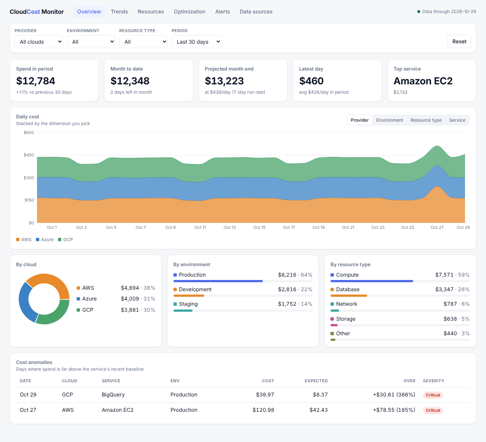
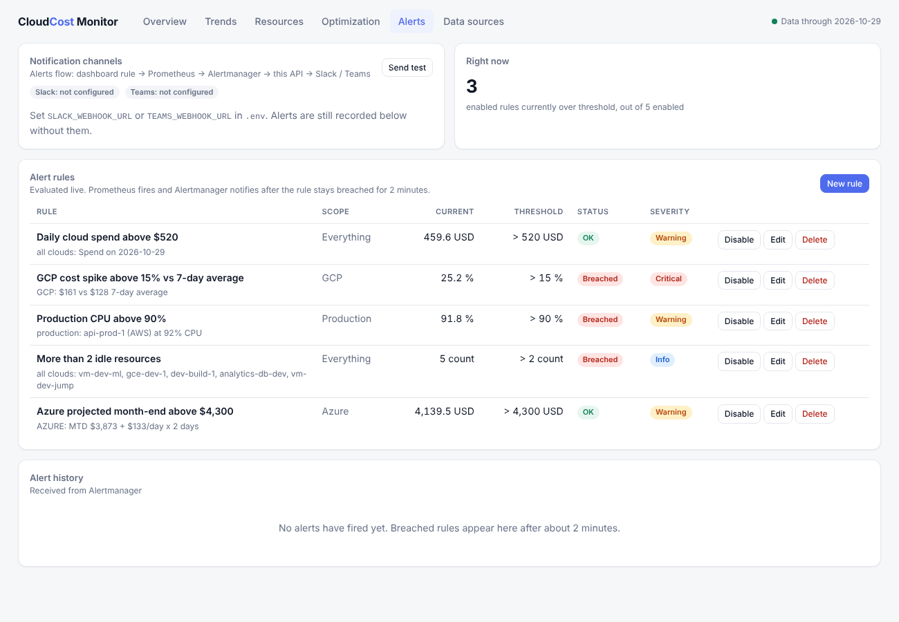
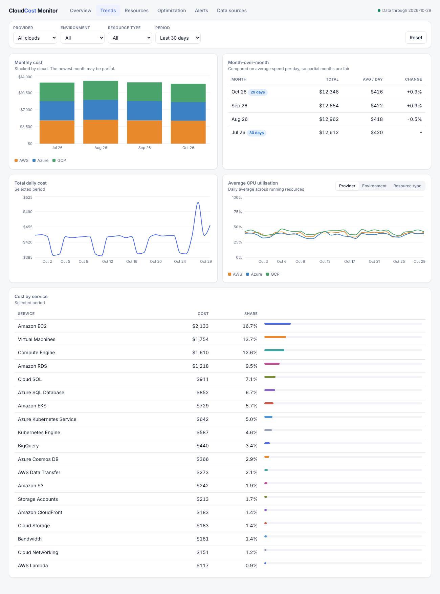
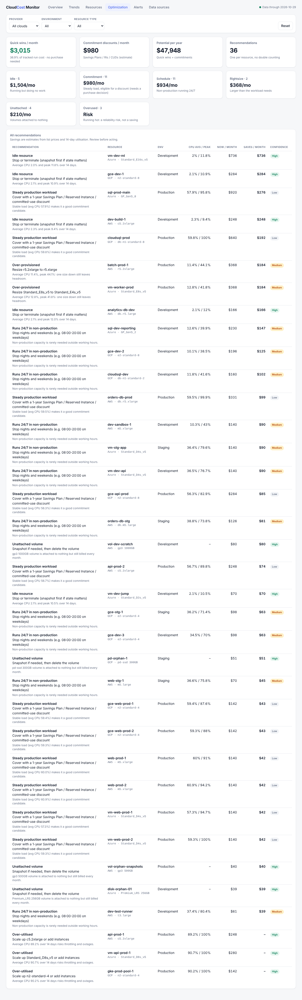

# DevOps Dashboard for Resource and Cost Monitoring

One dashboard for spend and resource utilisation across **AWS, Azure and GCP**: real-time and
historical charts, filters by cloud / environment / resource type, user-defined alerts that
reach **Slack or Microsoft Teams**, and a cost-optimisation engine that quantifies savings.

Runs with **no cloud accounts** out of the box (deterministic demo data), and switches each
provider to live data with one setting.

| Layer | Technology |
|---|---|
| Collectors, API, analytics | Python 3.12, FastAPI, SQLAlchemy, APScheduler |
| Storage | PostgreSQL (SQLite for local dev and tests) |
| Dashboard | React 18, Vite, Recharts |
| Alerting | Prometheus + Alertmanager, notifier to Slack / Teams |
| Deployment | Docker Compose (5 containers) |

## Quick start (Docker)

```bash
cp .env.example .env          # defaults to mock data, nothing to fill in
docker compose up --build
```

| URL | What |
|---|---|
| http://localhost:8080 | Dashboard |
| http://localhost:8000/docs | REST API (Swagger) |
| http://localhost:9090 | Prometheus (alerts under *Alerts*) |
| http://localhost:9093 | Alertmanager |

The first start backfills about four months of data in a few seconds. Alerts for the default
rules fire roughly two minutes after startup.

## Run without Docker

```bash
# backend (SQLite, mock data)
cd backend && python -m venv .venv && . .venv/bin/activate
pip install -r requirements-dev.txt
uvicorn app.main:app --port 8000

# frontend (proxies /api to :8000)
cd frontend && npm install && npm run dev        # http://localhost:5173
```

## Tests

```bash
cd backend && pytest          # 114 tests
cd frontend && npm run build  # compile check
```

## Going live with real clouds

Set `AWS_MODE=live`, `AZURE_MODE=live` or `GCP_MODE=live` in `.env` and add credentials.
Required permissions and setup steps per cloud are in [docs/CLOUD_SETUP.md](docs/CLOUD_SETUP.md).
Use **Data sources → Test connection** in the UI to verify each one. Modes are independent, so
you can run AWS live while Azure and GCP stay on demo data.

## Slack / Teams

Put an incoming-webhook URL in `.env` (`SLACK_WEBHOOK_URL`, `TEAMS_WEBHOOK_URL`), restart the
backend, and press **Send test** on the Alerts page. See [docs/USER_GUIDE.md](docs/USER_GUIDE.md).

## Documentation

| Document | Contents |
|---|---|
| [docs/ARCHITECTURE.md](docs/ARCHITECTURE.md) | Components, data flow, schema, design decisions |
| [docs/USER_GUIDE.md](docs/USER_GUIDE.md) | Using each page, alert rules, troubleshooting |
| [docs/CLOUD_SETUP.md](docs/CLOUD_SETUP.md) | IAM / RBAC setup and live-mode configuration |
| [docs/COST_OPTIMIZATION.md](docs/COST_OPTIMIZATION.md) | How savings are found and estimated |
| [docs/TESTING.md](docs/TESTING.md) | What was tested, how, and what was not |
| [docs/SPRINTS.md](docs/SPRINTS.md) | Six-sprint plan mapped to the code |
| [docs/VIVA_PREP.md](docs/VIVA_PREP.md) | Likely viva questions with answers |

## Project layout

```
backend/app/
  collectors/   aws.py azure.py gcp.py mock.py   one class per provider, same interface
  services/     ingestion analytics optimizer alert_engine notifier utilization
  api/          REST routers (costs, resources, alerts, system)
  metrics.py    Prometheus exporter        scheduler.py  background jobs
  models.py     unified schema             normalize.py  provider vocab -> shared taxonomy
backend/tests/  114 tests
frontend/src/   pages/ (Overview Trends Resources Optimization Alerts Sources) components/
deploy/         prometheus/ alertmanager/
docker-compose.yml
```

## Known limitations

- Live collectors were written against the providers' documented APIs and their response
  parsing is unit-tested with sample payloads, but they have **not been run against real
  cloud accounts** (none were available while building). Expect to adjust permissions or
  tags on first connection.
- Per-resource monthly costs are **estimates** from list prices; billed spend comes from the
  provider billing APIs and is what the cost charts show.
- Run one backend process: the scheduler lives inside it.
- No user authentication on the dashboard or API; put it behind a VPN or reverse proxy with
  SSO before exposing it. `WEBHOOK_TOKEN` protects the Alertmanager webhook only.

## Screenshots

| Overview | Alerts |
|---|---|
|  |  |
|  |  |
