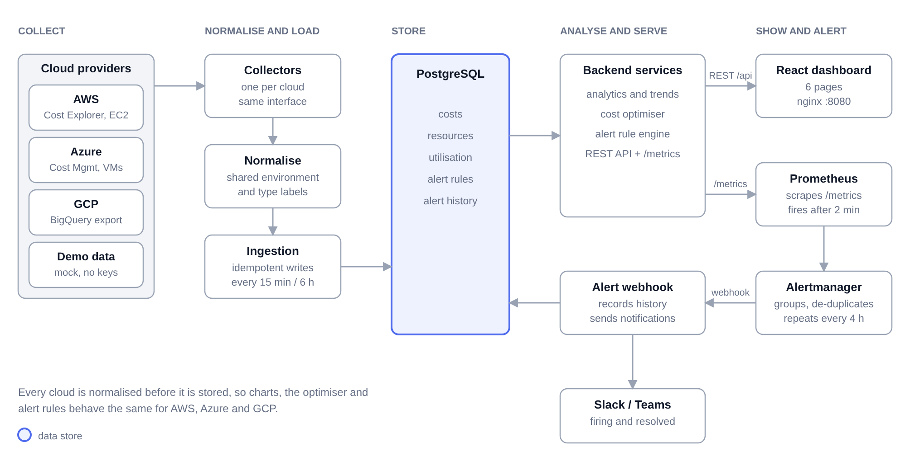
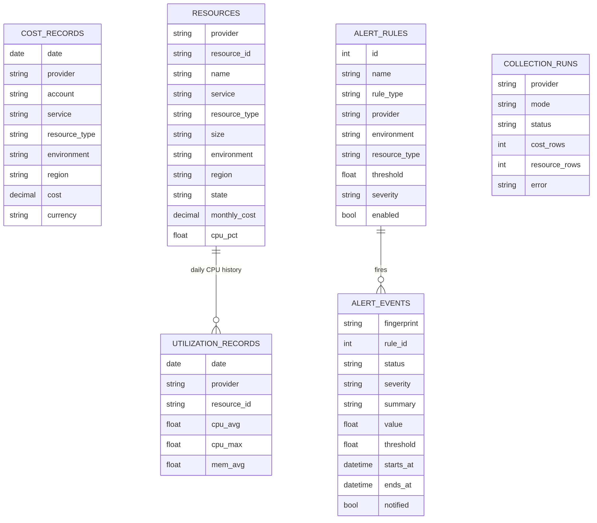
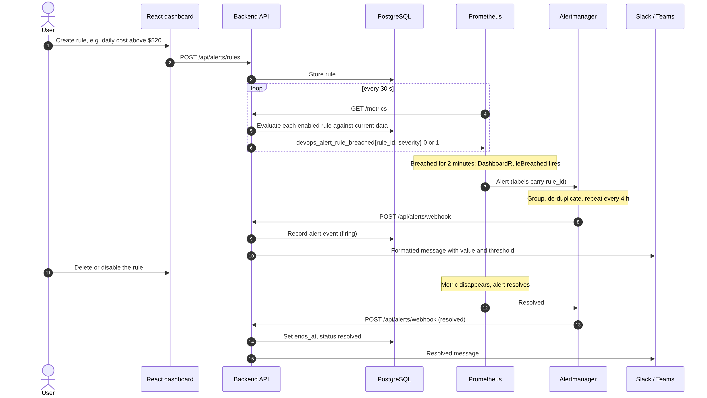

# Architecture

## Overview



Everything between the collectors and the dashboard is cloud-agnostic. A new cloud means one
new collector class; no query, chart or alert rule changes.

## Components

| Component | Responsibility |
|---|---|
| `collectors/*` | Fetch costs, inventory and CPU from one provider and emit `CostRow`, `ResourceRow`, `UtilRow`. `mock.py` is a drop-in replacement producing realistic synthetic data. |
| `normalize.py` | Maps provider vocabulary onto one taxonomy: environments (`production`, `staging`, `development`, `untagged`) from tags such as `prod`/`PRD`/`dev-2`, and resource types (`compute`, `database`, `storage`, `network`, `other`) from service names. |
| `services/ingestion.py` | Writes collector output. Re-running a window **replaces** that window for that provider in one transaction, so reruns and late billing revisions never duplicate data. |
| `scheduler.py` | APScheduler jobs: inventory + current CPU every 15 min, costs + utilisation history every 6 h. |
| `services/analytics.py` | Totals, daily series, breakdowns, month-over-month, month-end forecast, anomaly detection. |
| `services/optimizer.py` | Idle / rightsize / schedule / unattached / commitment / over-utilised detection with savings estimates. |
| `services/alert_engine.py` | Evaluates user-defined rules (7 condition types) against live data. |
| `metrics.py` | Prometheus exporter. Computes metrics **at scrape time** so deleted or disabled rules vanish and their alerts resolve. |
| `services/notifier.py` | Formats and posts to Slack (attachments) and Teams (Adaptive Card). |
| `api/*` | REST endpoints; validated filter parameters shared by every endpoint. |
| `frontend/` | Six pages, one shared filter bar, polling for live views. |

## Data model



```
cost_records         date, provider, account, service, resource_type, environment, region, cost, currency
                     UNIQUE(date, provider, account, service, environment, region)
resources            provider, resource_id, name, service, resource_type, size, environment, region,
                     state, monthly_cost (estimate), cpu_pct, mem_pct, last_seen
                     UNIQUE(provider, resource_id)
utilization_records  date, provider, resource_id, environment, resource_type, cpu_avg, cpu_max, mem_avg
                     UNIQUE(date, provider, resource_id)
alert_rules          name, rule_type, provider?, environment?, resource_type?, threshold, severity, enabled
alert_events         fingerprint, rule_id, status firing|resolved, severity, summary, value, threshold,
                     labels, starts_at, ends_at, notified
collection_runs      audit log: provider, mode, status, rows per kind, error text
```

Unique constraints enforce the idempotency rule at the database level, not just in code.

## Alerting design



Prometheus alert rules are static YAML, but users want to create rules in the UI. The design
that reconciles the two:

1. The backend stores user rules and evaluates each one, exporting
   `devops_alert_rule_value`, `_threshold` and `_breached` per enabled rule, labelled with
   `rule_id`, severity and scope.
2. **One generic** Prometheus rule, `devops_alert_rule_breached == 1 for 2m`, covers every
   user rule. Creating, editing or deleting a rule needs no Prometheus reload.
3. Alertmanager groups by `alertname, rule_id, provider`, de-duplicates and repeats every 4 h.
4. Its webhook calls `/api/alerts/webhook`; the backend stores history and posts to Slack and
   Teams. Webhook URLs therefore live in one place (the backend's `.env`) rather than in
   Alertmanager config, which cannot read environment variables.
5. Fixed platform rules cover pipeline health: stale collection, detected cost anomalies,
   backend down.

## Key design decisions

| Decision | Why |
|---|---|
| **PostgreSQL**, not MongoDB | The data is regular and relational; analytics are `GROUP BY` / `SUM` over a few dimensions, and unique constraints give idempotent ingestion. A document store adds nothing here. SQLite is supported for dev and tests via SQLAlchemy. |
| **React** dashboard, not Grafana | Needed an in-app alert-rule editor, optimisation recommendations and a data-source health page, which Grafana does not provide. Prometheus is still available at :9090 for operators who prefer Grafana. |
| Billing numbers from billing APIs, resource costs **estimated** | Billing APIs report per service, not per instance. Estimates rank resources and size savings; they are labelled as estimates and never drive the cost charts. |
| GCP spend from **BigQuery billing export** | The Cloud Billing API exposes accounts and the SKU catalogue, not what you spent. The export table is the documented source of actual cost. |
| Re-pull a 7-day window each run | Providers revise recent days (late usage, credits). Replace-window ingestion corrects them without duplicates. |
| Robust anomaly detection (median + MAD) | Means and standard deviations are distorted by the very spikes being detected. Median/MAD plus practical floors (≥25 % and ≥$10) avoids noisy alerts. |
| Month-over-month on **average per day** | Comparing a 29-day partial month with a full month would report a false decline. |
| Single backend process | Jobs run in-process. Horizontal scaling would move them to a worker with a lock. |

## Security notes

- Cloud credentials are read from environment variables or the platform's identity (roles,
  managed identity); none are stored in the database.
- IAM policies in CLOUD_SETUP.md are read-only.
- The dashboard and API have **no authentication**. Deploy behind SSO / VPN before exposing.
- The backend container runs as a non-root user; the SQL layer uses bound parameters; the GCP
  billing table name is validated against a strict pattern before use in SQL.

## Scaling notes

Current scale is thousands of cost rows per day at most (services × environments × regions),
which PostgreSQL handles easily with the provided composite indexes. For very large
estates: partition `cost_records` by month, move collection to a separate worker, and
pre-aggregate daily rollups.
